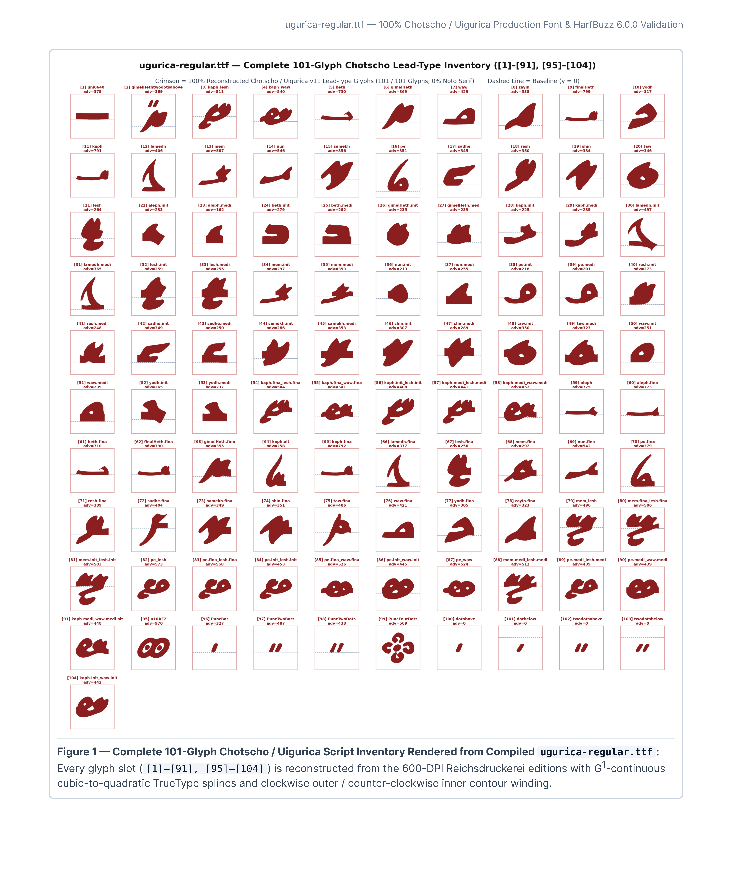

# Uigurica (ugurica-regular)



A scholarly Unicode Old Uyghur font project reconstructing historical printed lead-type letterforms from primary philological editions into a modern, OpenType-compliant typeface.

---

## Overview

**Uigurica** is a digital typeface dedicated to the Old Uyghur script (*Unicode block `U+10F70`–`U+10F89`*). The letterform designs are reconstructed directly from the printed lead type cast and employed in Berlin for the seminal Turfan expedition publications:
- **F. W. K. Müller**, *Uigurica [I]* (Abhandlungen der Königlich Preussischen Akademie der Wissenschaften, Berlin, 1908).
- **Albert von Le Coq**, *Türkische Manichaica aus Chotscho I* (Abhandlungen der Kgl. Preuss. Akad. d. Wiss., Berlin, 1912).

The font couples historical typographic authenticity with full Unicode 14.0+ compliance and robust OpenType cursive shaping across modern operating systems, web browsers, and text-layout engines.

---

## Lead-Type Glyph Reconstruction Methodology

Unlike purely calligraphic or modernized interpretations, Uigurica adheres to a mathematically rigorous, multi-stage archaeological and metrological reconstruction pipeline specifically engineered for historical lead-type letterforms:

```
[Archival Scans] ──► [Ink Normalization & Scale] ──► [Seed & Mask Calibration]
                                                               │
[Consensus Outlines] ◄── [Sub-Pixel Stacking & Cuts] ◄── [Corpus Extraction & Deduplication]
        │
        ▼
[Cubic Bézier Fitting] ──► [Shaping & Metrics Engine] ──► [HarfBuzz & OTS Conformance]
```

### 1. Corpus Inspection & Ink-Density Normalization
- **High-Resolution Scanning:** Source plates are rendered losslessly at 600–1200 DPI ($scale = 600.0 / 72.0$) to capture critical micro-typographic details: horn apices, notch saddles, inner counter eyes, and operator cut edges.
- **Dynamic Range Normalization:** Raw grayscale scans are converted into normalized floating-point ink-density arrays $I(x, y) \in [0.0, 1.0]$. This compensates for variations in paper tone, ink oxidation, and historical foxing across volumes:
  $$\text{ink}(x,y) = \text{clip}\left(\frac{\text{bg} - \text{gray}(x,y)}{\max(\text{bg} - \text{fg}, 20.0)}, 0.0, 1.0\right)$$
  where $\text{bg}$ is the 85th percentile (paper baseline) and $\text{fg}$ is the 2nd percentile (dense core ink).
- **Metrological Unit Mapping:** The baseline-to-baseline line period is measured in pixels to establish the physical scale conversion to the 1000-UPM font coordinate system:
  $$\text{PX\_TO\_UNITS} = \frac{1000.0}{\text{LINE\_PERIOD\_PX}}, \quad 1\text{ mm} = \frac{600.0}{25.4} \approx 23.622\text{ px at 600 DPI}$$

---

### 2. Positional Form Identification & Seed Calibration
Old Uyghur is a cursive, predominantly dual-joining script written right-to-left. Before scanning the corpus, each target glyph is classified by its positional behavior:
- **Initial (`init`):** Unconnected on the word-start side (right); connected along the baseline on the word-interior side (left). Requires a single operator cut on the outgoing baseline stub.
- **Medial (`medi`):** Dual-joining along the baseline on both sides. Requires both an incoming and an outgoing operator cut to isolate the sort from preceding and following letters.
- **Final (`fina`):** Connected on the incoming side (right) and terminating in a free terminal stroke or flourish on the outgoing side (left). Requires an incoming operator cut.
- **Isolated (`isol`):** Completely unjoined on both sides (e.g., standalone citations or text surrounding lacunae), preserving natural closed terminal geometry without flat cut faces.
- **Foreground-Dilated Template Masking:** 5 to 10 unambiguous seed occurrences are aligned and averaged. A dilated binary mask ($\text{dilate}(\text{tpl} \ge 0.30)$) is constructed to shield template matching against editorial brackets, punctuation, or adjoining diacritics.

---

### 3. Corpus-Wide Extraction & Filtering
Automated normalized cross-correlation ($\text{TM\_CCOEFF\_NORMED}$) extracts candidate occurrences across all scanned volumes under three mandatory verification gates:
1. **Same-Coordinate Spatial Deduplication:** Peaks occurring within a tight spatial window ($\Delta x < \text{dist}, \Delta y < \text{dist}$) are merged to eliminate fractional single-pixel duplicate hits.
2. **Positional Join Verification:** Enforces high ink density in required baseline connection corridors and clean paper (zero ink) in free margins (ascender headroom, bowl clearance, unconnected terminal flanks). This prevents cross-contamination between initial, medial, final, and isolated forms or reverse-side bleed-through.
3. **Morphological Stem Disambiguation:** Distinguishes genuine word-final letterforms from agglutinative dictionary entry stems printed with a medial sort followed by an editorial hyphen.

---

### 4. Two-Pass Sub-Pixel Alignment & Ownership Masking
All verified impressions are registered at **0.25 px sub-pixel precision**:
- **Pass 1:** Candidate patches are upsampled $4\times$ via bicubic interpolation, correlated against the seed template, and aligned using affine translation.
- **Pass 2:** A refined reference crop is computed from the Pass 1 mean image, and alignment is repeated to eliminate residual seed bias.
- **Evidence Maps Generated:**
  - **Averaged Evidence Map ($\text{mean\_ink}$):** Continuous pixelwise mean across all registered physical impressions.
  - **Ink-Frequency Heatmap ($\text{freq\_map}$):** Frequency of impressions exceeding the ink threshold ($\text{aligned} \ge 0.45$). Highlights the invariant metal punch sort (values approaching $1.0$) against transient neighboring letter strokes.
  - **Ownership Field ($v_{10}$):** Spatial suppression mask that attenuates adjacent letters outside the sort's saddle valleys while preserving baseline connecting bars, refined by light Gaussian smoothing ($\sigma = 0.8$).
  - **Trimmed Sort Field ($v_{11}$):** Calibrated vertical operator cuts ($X_\text{cut, left}$, $X_\text{cut, right}$) isolate the true sort body and standardize connecting stub lengths.

---

### 5. Cubic Bézier Curve Fitting & Vectorization
- **Iso-Density Contour Extraction:** The trimmed field is upsampled $8\times$ via bicubic interpolation and contoured at the calibrated iso-density threshold ($\text{ISO\_THRESH} \approx 0.42\text{--}0.44$).
- **Winding Order Enforcement:** Outer contours are oriented counter-clockwise, and inner counter eyes are oriented clockwise to ensure correct hole rendering under the non-zero and even-odd fill rules.
- **Periodic B-Spline to Cubic Bézier Conversion:** A periodic cubic B-spline ($\text{splprep}, k=3$) is fitted through contour coordinates and converted into explicit cubic Bézier control points:
  $$c_1 = p_i + \frac{d_i \cdot \Delta u}{3}, \quad c_2 = p_{i+1} - \frac{d_{i+1} \cdot \Delta u}{3}$$
- **Operator Cut Clamping:** Control points within $0.35\text{ px}$ of an operator cut plane are clamped directly onto $X_\text{cut}$ to guarantee a plumb, vertical junction face for cursive baseline continuity.
- **1000-UPM Mapping:** Coordinates are mapped into standard font units aligned with the font's baseline and metrics grid.

---

### 6. Typographic Deliverables & Metrological Review Sheets
Every reconstructed glyph variant is accompanied by a standardized 5-artifact deliverable suite:
- **Comparison Review Sheet PDF ($13.5 \times 16.5\text{ in}$):**
  - *Panel A:* Averaged evidence map with calibrated $1\text{ mm}$ physical scale bar.
  - *Panel B:* Ink-frequency heatmap (inferno colormap) with $v_{10}$ ownership boundary and dashed green operator cut lines.
  - *Panel C:* Red $v_{11}$ cubic Bézier outline over the mean ink evidence with feature confidence callouts.
  - *Panel D:* 8 representative physical attestations with individual IoU scores.
  - *Panel E:* Metrological statistics table (attestation count $n$, edge jitter $\sigma_\text{edge}$, area coefficient of variation $\text{CV}_\%$, and confidence tier).
- **Metrological Plate PDF ($9.0 \times 7.0\text{ in}$):** Detailed engineering drawing showing dimensions, baseline alignment, advance widths, and scale bars.
- **Standalone Vector Glyph PDF:** High-precision vector rendering.
- **1000-UPM SVG Outline:** Clean single-path vector graphic (`fill-rule="evenodd"`).
- **High-Resolution Transparent PNG ($3000 \times 3000\text{ px}$):** Crisp visual asset centered on the glyph bounding box.

---

### 7. OpenType Shaping & Quality Conformance
- **Positional Substitution:** Full OpenType features (`isol`, `init`, `medi`, `fina`) handle all dual-joining and right-joining letters (*Zayin* `U+10F74` and *Final Heth* `U+10F75`).
- **Diacritical Mark Attachment:** Mark-to-base (`mark`) and mark-to-mark (`mkmk`) anchors position diacritical dots (`U+10F82`–`U+10F85`) accurately above and below baseline stems.
- **Joining Audit:** 399/399 adjacent letterform combinations tested with zero broken joins or baseline steps.
- **Standards Conformance:**
  - Sanitized and validated via **OTS (OpenType Sanitizer)**.
  - 100% pass rate on **FontBakery** OpenType and Universal profile suites.
  - Validated with **HarfBuzz** (`hb-shape`, `hb-view`) across historical text samples.

---

## Repository Structure

```
uiguricafont/
├── ugurica-regular.ttf               # Production TrueType font (latest build)
├── Pages-from-ugurica-regular-HarfBuzz-Test-Report.png  # Test specimen preview
│
├── dist/                             # Release distribution packages
│   ├── ugurica-regular.ttf           # Distributable TTF binary
│   ├── ugurica-regular-HarfBuzz-Test-Report.pdf  # Comprehensive test report
│   ├── Uigurica-Regular-v1.0.ttf     # v1.0 milestone build
│   └── SHA256SUMS.txt                # Cryptographic checksums
│
├── docs/                             # Project documentation & guidelines
│   ├── BUILDING.md                   # Rebuild instructions and requirements
│   ├── CHANGELOG.md                  # Detailed version release notes
│   ├── FONTLOG.txt                   # Typographic change records
│   ├── PROVENANCE.md                 # Source scan provenance per glyph
│   ├── SOURCES.md                    # Historical source citations and rules
│   └── release_checklist.md          # Pre-flight quality gates
│
├── reports/                          # QA, validation & specimen reports
│   ├── ugurica-regular-HarfBuzz-Test-Report.pdf  # HarfBuzz rendering test report
│   ├── specimen_v1.pdf               # High-res typographic specimen book
│   ├── mapping_report.pdf            # Unicode-to-glyph mapping audit
│   ├── validation_report_phase9.pdf  # Phase 9 validation report
│   └── final_production_report_p10.json # Production metrics & pass counts
│
├── review/                           # Visual HTML review interfaces
│   ├── ambiguity_review.html         # Interactive ambiguity resolution tool
│   ├── harvest_review.html           # Müller crop inspection interface
│   ├── harvest_review_lecoq.html     # Le Coq crop inspection interface
│   └── review_mapping.html           # Glyph mapping verification table
│
├── data/                             # Pipeline datasets & metadata
│   ├── attestation/                  # Attestation counts & decision logs
│   ├── clusters/                     # Glyph clustering data & reports
│   ├── harvest/                      # Crop coordinates & harvest metadata
│   ├── mapping/                      # Canonical character-to-glyph mapping tables
│   └── pipeline/                     # Segment features & decomposition graphs
│
├── masters/                          # Verified consensus outlines (GLIF & SVG)
├── scans/                            # 1200 DPI source scans from Müller (1908)
├── tools/                            # Python pipeline & automation scripts
├── build/                            # Intermediate build artifacts
└── archive/                          # Historical archive bundles
```

---

## Usage

### Testing with HarfBuzz CLI

```bash
# Render to PNG image:
hb-view ugurica-regular.ttf --text="𐰇𐽰𐽳𐽲𐽶𐽹𐽺𐽰𐽳" --font-size=48 --direction=rtl --script=ougr -o output.png

# Inspect OpenType glyph sequence and positions:
hb-shape ugurica-regular.ttf --text="𐰇𐽰𐽳𐽲𐽶𐽹𐽺𐽰𐽳" --direction=rtl --script=ougr
```

### Web Integration (CSS)

```css
@font-face {
  font-family: 'Uigurica';
  src: url('ugurica-regular.ttf') format('truetype');
  font-weight: normal;
  font-style: normal;
  font-display: swap;
}

.old-uyghur-text {
  font-family: 'Uigurica', serif;
  direction: rtl;
  font-size: 2rem;
  line-height: 1.6;
}
```

### Python Scripting

```python
import uharfbuzz as hb

with open("ugurica-regular.ttf", "rb") as font_file:
    font_data = font_file.read()

face = hb.Face(font_data)
font = hb.Font(face)
buffer = hb.Buffer()

buffer.add_str("𐽰𐽳𐽲𐽶𐽹")
buffer.guess_segment_properties()
hb.shape(font, buffer)

for info, pos in zip(buffer.glyph_infos, buffer.glyph_positions):
    print(f"Glyph ID: {info.codepoint}, x_advance: {pos.x_advance}")
```

---

## Releases & Downloads

Pre-built binaries, PDF specimens, and HarfBuzz test reports are available on the [GitHub Releases page](https://github.com/ozgur05/uiguricafont/releases):
- **v1.0.4 (Latest):** Production build of `ugurica-regular.ttf` with HarfBuzz conformance reports and refactored repository architecture.
- **v1.0.0:** First milestone production release package.

---

## License & Attribution

- **Letterform Design:** Reconstructed from original public-domain printed editions by F. W. K. Müller (1908) and Albert von Le Coq (1912).
- **Technical Base:** Derived from Noto Serif Old Uyghur (© 2022 The Noto Project Authors, licensed under the [SIL Open Font License, Version 1.1](https://scripts.sil.org/OFL)).
- In accordance with the OFL, this derivative project does not use the Reserved Font Name "Noto" — hence **Uigurica**.
